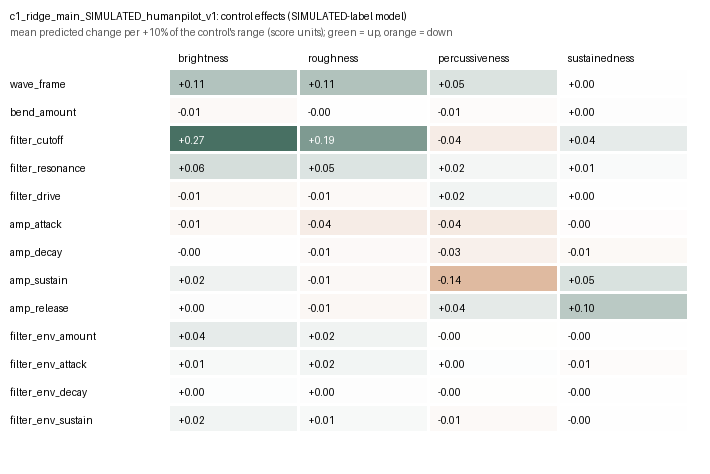

# Control effects: c1_ridge_main_SIMULATED_humanpilot_v1

> **Model trained on SIMULATED ratings.** These are effects of an artificial rule. They test the software, not perception.

40 base patches spread over the corpus, 13 controls, steps -20%, -10%, -5%, +5%, +10%, +20% of each control's range, one control at a time (2478 Vital renders, same settings as the corpus).

## Mean predicted change per +10% of a control's range (score units, 1–7 scale)

| Control | brightness | roughness | percussiveness | sustainedness |
|---|---|---|---|---|
| wave_frame | +0.11 (±0.33, 63%) | +0.11 (±0.25, 60%) | +0.05 (±0.14, 57%) | +0.00 (±0.07, 47%) |
| bend_amount | -0.01 (±0.12, 57%) | -0.00 (±0.10, 54%) | -0.01 (±0.07, 61%) | +0.00 (±0.04, 50%) |
| filter_cutoff | +0.27 (±0.25, 90%) | +0.19 (±0.22, 79%) | -0.04 (±0.19, 45%) | +0.04 (±0.09, 66%) |
| filter_resonance | +0.06 (±0.19, 59%) | +0.05 (±0.13, 52%) | +0.02 (±0.14, 55%) | +0.01 (±0.04, 55%) |
| filter_drive | -0.01 (±0.05, 57%) | -0.01 (±0.04, 60%) | +0.02 (±0.07, 60%) | +0.00 (±0.01, 43%) |
| amp_attack | -0.01 (±0.15, 45%) | -0.04 (±0.08, 76%) | -0.04 (±0.12, 70%) | -0.00 (±0.05, 61%) |
| amp_decay | -0.00 (±0.06, 42%) | -0.01 (±0.07, 50%) | -0.03 (±0.08, 67%) | -0.01 (±0.02, 81%) |
| amp_sustain | +0.02 (±0.09, 76%) | -0.01 (±0.08, 61%) | -0.14 (±0.15, 97%) | +0.05 (±0.05, 94%) |
| amp_release | +0.00 (±0.02, 79%) | -0.01 (±0.02, 86%) | +0.04 (±0.05, 72%) | +0.10 (±0.08, 86%) |
| filter_env_amount | +0.04 (±0.07, 78%) | +0.02 (±0.04, 81%) | -0.00 (±0.04, 38%) | -0.00 (±0.02, 59%) |
| filter_env_attack | +0.01 (±0.05, 63%) | +0.02 (±0.07, 63%) | +0.00 (±0.06, 44%) | -0.01 (±0.03, 67%) |
| filter_env_decay | +0.00 (±0.01, 83%) | +0.00 (±0.01, 73%) | -0.00 (±0.02, 57%) | -0.00 (±0.01, 57%) |
| filter_env_sustain | +0.02 (±0.05, 80%) | +0.01 (±0.03, 77%) | -0.01 (±0.03, 67%) | -0.00 (±0.02, 37%) |

Cells: mean (± SD across base patches, share of bases with the same direction at +10%).

## Inactive-context check

| Context | Control | Max |effect| in context | Typical |effect| when active |
|---|---|---|---|
| env_depth_zero | filter_env_attack | 0.000 | 0.029 |
| env_depth_zero | filter_env_decay | 0.000 | 0.010 |
| env_depth_zero | filter_env_sustain | 0.000 | 0.033 |
| env_sustain_one | filter_env_decay | 0.000 | 0.010 |
| amp_sustain_one | amp_decay | 0.000 | 0.070 |

## Files

- `effects_long.csv`: every base × control × step with the four predicted changes
- `effect_summary.csv`: mean, spread, sign consistency, linearity (+20% vs +10%) and asymmetry (+10% plus −10%)
- `inactive_context_check.csv`: controls that should do nothing in a forced context
- `validation_pair_candidates.csv`: original/changed pairs for a later listening check (predicted increase, decrease, negligible, weak support)

Effects are local and conditional on the base patch, the audio processing and the model. A feature weight is not a control effect; these numbers come from actually re-rendering the patch.
