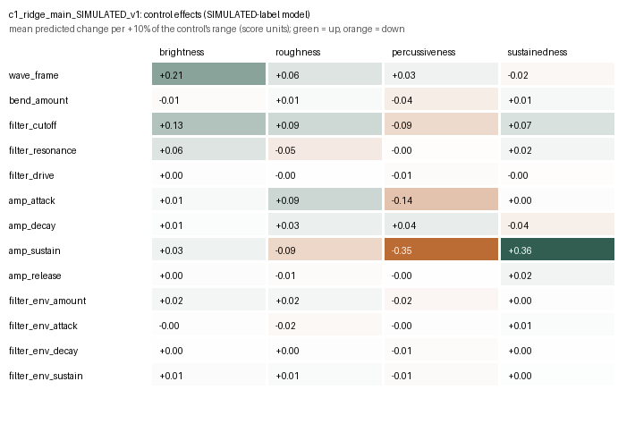

# Control effects: c1_ridge_main_SIMULATED_v1

> **Model trained on SIMULATED ratings.** These are effects of an artificial rule. They test the software, not perception.

40 base patches spread over the corpus, 13 controls, steps -20%, -10%, -5%, +5%, +10%, +20% of each control's range, one control at a time (2499 Vital renders, same settings as the corpus).

## Mean predicted change per +10% of a control's range (score units, 1–7 scale)

| Control | brightness | roughness | percussiveness | sustainedness |
|---|---|---|---|---|
| wave_frame | +0.21 (±0.43, 60%) | +0.06 (±0.48, 50%) | +0.03 (±0.11, 67%) | -0.02 (±0.26, 53%) |
| bend_amount | -0.01 (±0.07, 59%) | +0.01 (±0.45, 59%) | -0.04 (±0.36, 50%) | +0.01 (±0.15, 53%) |
| filter_cutoff | +0.13 (±0.16, 77%) | +0.09 (±0.66, 57%) | -0.09 (±0.27, 70%) | +0.07 (±0.25, 57%) |
| filter_resonance | +0.06 (±0.16, 69%) | -0.05 (±0.19, 38%) | -0.00 (±0.07, 47%) | +0.02 (±0.16, 69%) |
| filter_drive | +0.00 (±0.04, 50%) | -0.00 (±0.08, 67%) | -0.01 (±0.16, 61%) | -0.00 (±0.13, 64%) |
| amp_attack | +0.01 (±0.04, 60%) | +0.09 (±0.52, 34%) | -0.14 (±0.24, 63%) | +0.00 (±0.23, 60%) |
| amp_decay | +0.01 (±0.04, 29%) | +0.03 (±0.21, 61%) | +0.04 (±0.34, 84%) | -0.04 (±0.16, 68%) |
| amp_sustain | +0.03 (±0.04, 97%) | -0.09 (±0.17, 73%) | -0.35 (±0.42, 97%) | +0.36 (±0.28, 97%) |
| amp_release | +0.00 (±0.01, 76%) | -0.01 (±0.02, 82%) | -0.00 (±0.05, 71%) | +0.02 (±0.08, 32%) |
| filter_env_amount | +0.02 (±0.03, 67%) | +0.02 (±0.24, 58%) | -0.02 (±0.09, 48%) | +0.00 (±0.06, 52%) |
| filter_env_attack | -0.00 (±0.02, 61%) | -0.02 (±0.31, 65%) | -0.00 (±0.15, 61%) | +0.01 (±0.07, 48%) |
| filter_env_decay | +0.00 (±0.01, 57%) | +0.00 (±0.17, 46%) | -0.01 (±0.05, 50%) | +0.00 (±0.04, 50%) |
| filter_env_sustain | +0.01 (±0.02, 64%) | +0.01 (±0.18, 33%) | -0.01 (±0.06, 79%) | +0.00 (±0.11, 79%) |

Cells: mean (± SD across base patches, share of bases with the same direction at +10%).

## Inactive-context check

| Context | Control | Max |effect| in context | Typical |effect| when active |
|---|---|---|---|
| env_depth_zero | filter_env_attack | 0.000 | 0.058 |
| env_depth_zero | filter_env_decay | 0.000 | 0.020 |
| env_depth_zero | filter_env_sustain | 0.000 | 0.045 |
| env_sustain_one | filter_env_decay | 0.000 | 0.020 |
| amp_sustain_one | amp_decay | 0.000 | 0.136 |

## Files

- `effects_long.csv`: every base × control × step with the four predicted changes
- `effect_summary.csv`: mean, spread, sign consistency, linearity (+20% vs +10%) and asymmetry (+10% plus −10%)
- `inactive_context_check.csv`: controls that should do nothing in a forced context
- `validation_pair_candidates.csv`: original/changed pairs for a later listening check (predicted increase, decrease, negligible, weak support)

Effects are local and conditional on the base patch, the audio processing and the model. A feature weight is not a control effect; these numbers come from actually re-rendering the patch.
