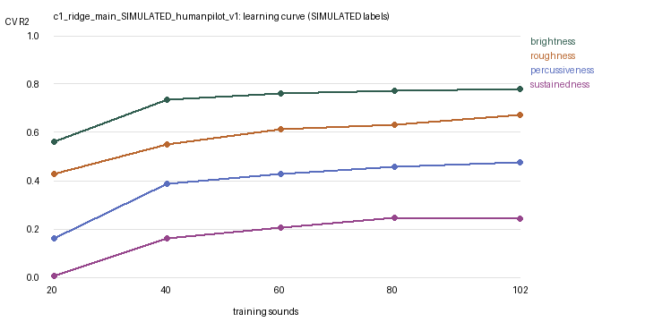

# Validity evaluation: c1_ridge_main_SIMULATED_humanpilot_v1

> **SIMULATED labels.** These results check the software against an artificial rule. They are not evidence about human timbre perception.

128 sounds, sound-grouped 5-fold CV, penalty re-chosen inside every training fold.

## 1–2. Stability and significance

| Descriptor | CV MAE [95% range] | Baseline MAE | CV R² [95% range] | Spearman | Beats baseline | Permutation p |
|---|---|---|---|---|---|---|
| brightness | 0.58 [0.55, 0.62] | 1.33 | 0.78 [0.75, 0.81] | 0.86 | 100% of 20 | 0.005 |
| roughness | 0.72 [0.69, 0.76] | 1.29 | 0.67 [0.63, 0.69] | 0.81 | 100% of 20 | 0.005 |
| percussiveness | 0.70 [0.68, 0.73] | 0.99 | 0.49 [0.43, 0.53] | 0.65 | 100% of 20 | 0.005 |
| sustainedness | 0.64 [0.63, 0.65] | 0.76 | 0.26 [0.24, 0.28] | 0.48 | 100% of 20 | 0.005 |

## 3. Listener ceiling and new listeners

| Descriptor | Split-half r | Reliability of mean | Noise ceiling r | Model CV r | Share of ceiling | Model→new listeners r | Listeners→other listeners r |
|---|---|---|---|---|---|---|---|
| brightness | 0.84 | 0.92 | 0.96 | 0.88 | 92% | 0.85 | 0.84 |
| roughness | 0.81 | 0.89 | 0.95 | 0.81 | 86% | 0.78 | 0.81 |
| percussiveness | 0.63 | 0.77 | 0.88 | 0.69 | 79% | 0.63 | 0.63 |
| sustainedness | 0.42 | 0.59 | 0.77 | 0.50 | 65% | 0.42 | 0.42 |

## 4. Construct validity (which measurements carry each descriptor)

| Descriptor | Spectral only R² | Temporal only R² | Modulation only R² | Strongest | Expected | Match |
|---|---|---|---|---|---|---|
| brightness | 0.80 | -0.02 | 0.02 | spectral | spectral | yes |
| roughness | 0.65 | -0.02 | -0.01 | spectral | modulation | no |
| percussiveness | 0.39 | 0.33 | 0.01 | spectral | temporal | no |
| sustainedness | 0.01 | 0.24 | 0.03 | temporal | temporal | yes |

## 5. Learning curve (CV R² by number of training sounds)

| Descriptor | 20 | 40 | 60 | 80 | 102 | Still improving |
|---|---|---|---|---|---|---|
| brightness | 0.56 | 0.73 | 0.76 | 0.77 | 0.78 | no |
| roughness | 0.43 | 0.55 | 0.61 | 0.63 | 0.67 | yes |
| percussiveness | 0.16 | 0.39 | 0.43 | 0.46 | 0.48 | no |
| sustainedness | 0.00 | 0.16 | 0.21 | 0.25 | 0.24 | no |

## 6. Robustness and calibration

| Descriptor | Median-target R² | Calibration slope | Mean error low / middle / high |
|---|---|---|---|
| brightness | 0.74 | 1.03 | +0.45 / -0.09 / -0.37 |
| roughness | 0.57 | 1.01 | +0.56 / -0.09 / -0.52 |
| percussiveness | 0.45 | 0.95 | +0.82 / -0.34 / -0.55 |
| sustainedness | 0.21 | 1.03 | +0.66 / +0.00 / -0.84 |

Simulation recovery (CV predictions vs hidden truth, Spearman): brightness 0.93, roughness 0.88, percussiveness 0.79, sustainedness 0.59

## How to read this

- **Valid baseline:** beats the baseline in nearly all repeats, permutation p < 0.05, and the strongest feature group matches the descriptor's meaning.
- **Ceiling:** model correlation cannot exceed the noise ceiling set by listener agreement. A high share of the ceiling means more listeners, not a bigger model, is the route to improvement.
- **New listeners:** if 'Model→new listeners' is close to 'Listeners→other listeners', the model predicts unseen people about as well as other people do.
- **Learning curve:** if R² is still rising at the largest size, more rated sounds would help.
- **Calibration:** a slope above 1 and positive error at low / negative at high targets means predictions are pulled toward the middle of the scale.
