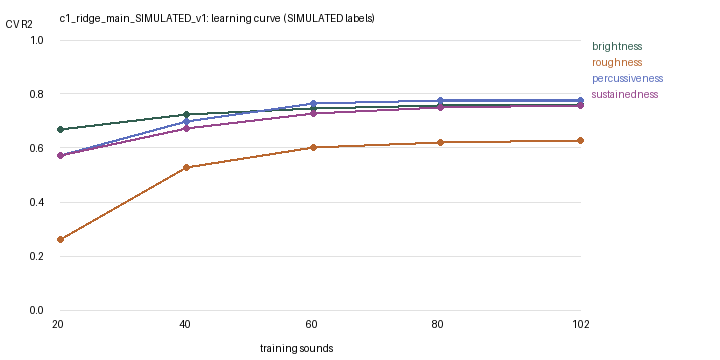

# Validity evaluation: c1_ridge_main_SIMULATED_v1

> **SIMULATED labels.** These results check the software against an artificial rule. They are not evidence about human timbre perception.

128 sounds, sound-grouped 5-fold CV, penalty re-chosen inside every training fold.

## 1–2. Stability and significance

| Descriptor | CV MAE [95% range] | Baseline MAE | CV R² [95% range] | Spearman | Beats baseline | Permutation p |
|---|---|---|---|---|---|---|
| brightness | 0.56 [0.54, 0.58] | 1.19 | 0.77 [0.75, 0.79] | 0.83 | 100% of 20 | 0.005 |
| roughness | 0.65 [0.61, 0.68] | 1.14 | 0.64 [0.61, 0.68] | 0.81 | 100% of 20 | 0.005 |
| percussiveness | 0.49 [0.48, 0.52] | 1.16 | 0.80 [0.78, 0.81] | 0.89 | 100% of 20 | 0.005 |
| sustainedness | 0.55 [0.51, 0.60] | 1.16 | 0.76 [0.72, 0.79] | 0.87 | 100% of 20 | 0.005 |

## 3. Listener ceiling and new listeners

| Descriptor | Split-half r | Reliability of mean | Noise ceiling r | Model CV r | Share of ceiling | Model→new listeners r | Listeners→other listeners r |
|---|---|---|---|---|---|---|---|
| brightness | 0.81 | 0.90 | 0.95 | 0.88 | 93% | 0.84 | 0.81 |
| roughness | 0.70 | 0.82 | 0.91 | 0.80 | 88% | 0.74 | 0.70 |
| percussiveness | 0.83 | 0.91 | 0.95 | 0.89 | 94% | 0.85 | 0.83 |
| sustainedness | 0.80 | 0.89 | 0.94 | 0.87 | 92% | 0.82 | 0.80 |

## 4. Construct validity (which measurements carry each descriptor)

| Descriptor | Spectral only R² | Temporal only R² | Modulation only R² | Strongest | Expected | Match |
|---|---|---|---|---|---|---|
| brightness | 0.82 | -0.02 | 0.03 | spectral | spectral | yes |
| roughness | 0.07 | 0.04 | 0.72 | modulation | modulation | yes |
| percussiveness | 0.12 | 0.82 | -0.00 | temporal | temporal | yes |
| sustainedness | 0.17 | 0.77 | 0.07 | temporal | temporal | yes |

## 5. Learning curve (CV R² by number of training sounds)

| Descriptor | 20 | 40 | 60 | 80 | 102 | Still improving |
|---|---|---|---|---|---|---|
| brightness | 0.67 | 0.72 | 0.74 | 0.76 | 0.76 | no |
| roughness | 0.26 | 0.53 | 0.60 | 0.62 | 0.63 | no |
| percussiveness | 0.57 | 0.70 | 0.77 | 0.78 | 0.78 | no |
| sustainedness | 0.57 | 0.67 | 0.73 | 0.75 | 0.76 | no |

## 6. Robustness and calibration

| Descriptor | Median-target R² | Calibration slope | Mean error low / middle / high |
|---|---|---|---|
| brightness | 0.65 | 0.98 | +0.42 / -0.07 / -0.29 |
| roughness | 0.60 | 1.00 | +0.46 / +0.09 / -0.63 |
| percussiveness | 0.76 | 1.01 | +0.26 / -0.11 / -0.31 |
| sustainedness | 0.69 | 0.99 | +0.33 / -0.01 / -0.34 |

Simulation recovery (CV predictions vs hidden truth, Spearman): brightness 0.91, roughness 0.93, percussiveness 0.93, sustainedness 0.91

## How to read this

- **Valid baseline:** beats the baseline in nearly all repeats, permutation p < 0.05, and the strongest feature group matches the descriptor's meaning.
- **Ceiling:** model correlation cannot exceed the noise ceiling set by listener agreement. A high share of the ceiling means more listeners, not a bigger model, is the route to improvement.
- **New listeners:** if 'Model→new listeners' is close to 'Listeners→other listeners', the model predicts unseen people about as well as other people do.
- **Learning curve:** if R² is still rising at the largest size, more rated sounds would help.
- **Calibration:** a slope above 1 and positive error at low / negative at high targets means predictions are pulled toward the middle of the scale.
